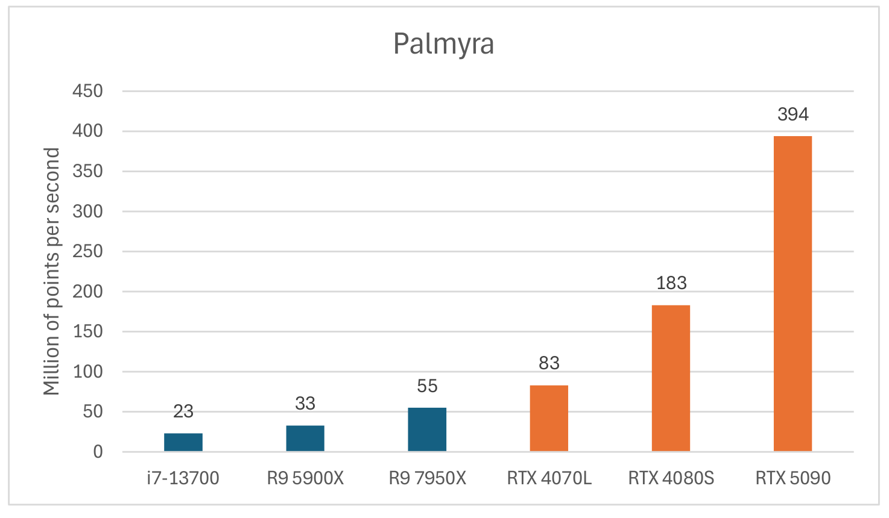

# CuLAZ: GPU-Accelerated LAZ Decoding


Paper: "CuLAZ: GPU-Accelerated LAZ Decoding", Elias Kristmann, Michael Wimmer, Markus Schütz, EUROGRAPHICS Workshop on Graphics and Cultural Heritage 2026 (coming soon)

CuLAZ decodes LASzip-compressed point clouds (LAZ) on the GPU with CUDA. It operates directly on standard LAZ files, without changes to the compressed representation, and produces output that is bit-for-bit identical to the official LASzip decoder. Across five real-world LiDAR datasets and three GPU systems, CuLAZ decodes up to 540 million points per second and is up to 7x faster than a parallel CPU implementation.



Decompression throughput of the Palmyra scan (258 million points). Blue: parallel LASzip decoder on the CPU. Orange: CuLAZ on the GPU.


## Supported Input

CuLAZ currently decodes the LAZ layout that LASzip writes by default for <b>point format 2</b> (XYZ, intensity, return info, classification, scan angle, user data, point source ID, RGB):
- Pointwise chunked compression with LASzip item version 2 (`POINT10` + `RGB12`).
- Any fixed chunk size. Variable-sized chunks are not supported.
- No extra bytes per point.

## Installing


### Windows

Dependencies: 
* CUDA 13.2
* Visual Studio 2022 (version 17.14)
* CMake 3.31
* A GPU with compute capability 7.5 or newer

Configure and build from the repository root:

```
cmake -S . -B build
cmake --build build --config Release
```

This produces `build\Release\CuLAZ.exe`, which is run from the command line:

```
build\Release\CuLAZ.exe path\to\pointcloud.laz
```


## Usage

```
CuLAZ <file.laz | directory> [options]
```

If a directory is given, all `.laz` files in it are decoded in one combined GPU queue.

* `--iterations N`: Number of timed runs after one warm-up.
* `--gpu-only`: Skip the multithreaded LASzip CPU baseline.
* `--validate`: Copy the decoded points to the host and compare the first 10 million points of each file against LASzip.
* `--no-stats`: Skip the point cloud statistics.
* `--batch-chunks N`: Limit the number of chunks per GPU batch.

## Acknowledgements

The authors thank Iconem for the Palmyra and Saint Roman data sets, Pix4D for the Matterhorn data set, Louisiana State University's College of Art and Design for the Rosedown data set, and EDYTEM / Université Savoie Mont Blanc / CNRS for the Elaphes cave data set. This research has been funded by WWTF project ICT22-055 - Instant Visualization and Interaction for Large Point Clouds and WWTF project ICT25-084 - Instant Visualization and Editing of Arbitrarily Large 3D Data Sets.

## License

CuLAZ is released under the [Apache License 2.0](LICENSE). It includes and ports code from <b>LASzip</b> 3.5.0 by rapidlasso GmbH (Apache License 2.0), whose arithmetic coder is derived from <b>FastAC</b> by Amir Said and William A. Pearlman (BSD 2-Clause). See [NOTICE](NOTICE) for attributions and the files we modified.

## Citing

Coming soon.
